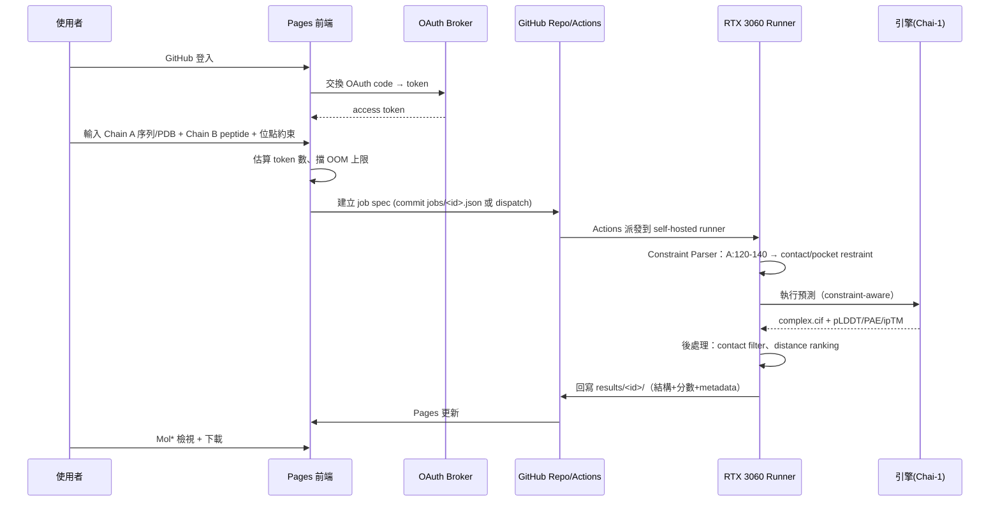
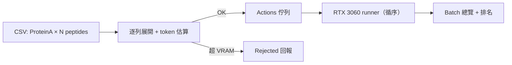

# Protein–Peptide Binding-Site Constrained Structure Prediction Platform
## 工程規格文件（Engineering Specification）

> 版本 v0.1 ｜ 2026-11-26
> 依據 `protein_peptide_binding_platform_prompt.md` 的規劃撰寫，並對齊真實部署條件：
> **單機 RTX 3060 (12GB)、GitHub Pages 前端、GitHub Actions self-hosted runner 把運算派回本機。**
> Prompt 中的 Kubernetes / GPU cluster / 雲端叢集列為 **Phase 4 擴展路線**，非 MVP。

鏈定義（全文強制）：**Protein = Chain A，Peptide = Chain B**。所有 constraint 皆以 `Chain A ↔ Chain B` 形式表達。

---

## 0. 設計取捨總綱（Executive Summary）

這份規格的核心取捨來自一個事實：**我們沒有 GPU 叢集，只有一張 12GB 的 RTX 3060，且開發與運算同機。** 因此架構不走「雲端微服務 + K8s + 大量 GPU」，而走一個更省、更貼合現況的模式：

- **前端 = GitHub Pages 靜態站**（零伺服器成本），GitHub OAuth 當會員系統。
- **佇列 = GitHub Actions**（天然的 job queue + 稽核紀錄），不自建 Redis/Celery。
- **運算 = self-hosted runner on RTX 3060**：Actions 把 job 派回本機跑開源模型，單 GPU 循序處理。
- **結果 = Git/Artifacts + Pages 可視化**：結構檔與信心分數回傳，前端用 Mol*/3Dmol.js 呈現。
- **引擎 = Chai-1（主）/ Boltz-2（備）**：皆開源可商用、原生支援 residue-level 結合位點約束。

這個模式讓 MVP 幾乎零月費就能上線；當需求長大，Phase 4 再把「Actions + 單 runner」換成「真正的 job queue + GPU 叢集」，前端與資料模型不必重寫。

---

## 1. 可行性分析（Feasibility Analysis）

### 1.1 為什麼用現成開源模型，而非自訓

Prompt 已定調：利用具 AF3 式 constraint 機制的開源模型當後端引擎，不自行訓練。這在科學與工程上都正確——自訓一個 AF3 等級模型需要數百張 H100 與龐大資料策展，與本專案目標（**把結合位點約束變成可用的產品**）無關。

### 1.2 三個候選引擎

| 引擎 | 開發者 | 授權 | 結合位點約束 | 備註 |
|------|--------|------|--------------|------|
| **Chai-1** | Chai Discovery | **Apache 2.0**（程式碼＋權重，可商用） | **pocket / contact / docking** 三類 restraint | 約束介面最直覺，商用最乾淨 |
| **Boltz-2** | MIT (Wohlwend et al.) | **MIT**（可商用） | pocket + contact **＋ steering potentials（強制約束）** | 約束「更守規矩」；另有 affinity head（但對 peptide 不可靠） |
| **Boltz-1** | MIT | **MIT** | pocket / contact（YAML 條件） | Boltz-2 的前身，約束為「條件」非強制 |
| ~~AlphaFold3~~ | DeepMind | 權重**商用受限**、需申請 | contact/pocket | ❌ 不選：授權不允許公開商用部署 |

**約束機制細節（查證自官方與第三方文件）：**

- **Chai-1 restraints**（`chai-lab`）：
  - *contact*：連結兩條鏈上各一個 residue，設定距離上界，格式 `chainA:resIdx, chainB:resIdx | max_distance`（預設 8 Å）。
  - *pocket*：較軟、較粗；指定鏈上任一 residue 滿足即可，格式 `ligand_chain | protein:res1,res2 | max_distance`（預設 6 Å），**soft restraint（非嚴格強制）**。
  - *docking*：介於兩者之間。
  - 官方報告：對 antibody–antigen，加 2 個隨機 contact restraint 可明顯提升介面準確度；pocket 幫助較小（因較不具體）。
- **Boltz-2**：pocket/contact 不只用特徵條件，還疊加 **steering potentials** 在取樣時「推」結構滿足約束，比 Boltz-1 的純條件更可靠。限制：`pocket.binder` 只支援單一鏈；**affinity head 對 >50 atoms 的配體（含多數 peptide）預測不準** → 本平台只取其**結構**輸出，不取 affinity。

**結論**：三者都能做「指定 Chain A 位點、引導 Chain B 結合」。選 **Chai-1 為主引擎**（約束直覺、Apache 可商用），**Boltz-2 為對照/備援**（steering 強制力更強，可做交叉驗證）。

### 1.3 RTX 3060 (12GB) 的硬體可行性 ★關鍵

這是整個專案最硬的約束。公開資料點：

- Boltz-2 在模擬 **24GB** 上限下約可處理 **~1600 tokens**；開 chunking 可延伸到 **2660+ tokens**（bioRxiv，H200 模擬）。
- 第三方部署側寫：典型 protein–ligand 推論約 **20–30GB**（在 80GB 卡上），記憶體隨蛋白長度成長。
- 有專門研究（LMI4Boltz, bioRxiv 2025）在**消費級硬體**上優化 VRAM 以跑大型複合體。

**推算到 12GB**（約 24GB 之半，再扣框架開銷）：

| 系統規模（Chain A 殘基 + peptide） | 12GB 可行性 | 設定 |
|---|---|---|
| 小型：蛋白 ≤ ~350 aa + peptide ≤ ~20 aa | ✅ 可跑 | 關 templates、縮 MSA、開 low-memory/chunking |
| 中型：蛋白 ~350–600 aa | ⚠️ 邊緣 | 必須 chunking + 降精度(bf16/fp16)、可能需切域 |
| 大型：蛋白 > ~700 aa，或多鏈大複合體 | ❌ 易 OOM | 需 24GB+ 或雲端 GPU（Phase 4） |

**對產品的直接影響**：MVP 先鎖定 **小型 protein–peptide 系統**（KIF2C 本身催化域約 ~320 aa，落在可行區）。前端要在送單前做 **token 估算與上限擋關**，避免使用者送出必定 OOM 的 job。

### 1.4 可行性結論

- **技術可行**：開源引擎原生支援我們要的 residue-level 結合位點約束，授權允許公開商用部署。
- **硬體受限但 MVP 可成立**：單張 3060 足以跑小型 protein–peptide，適合驗證產品價值；大型系統與高吞吐留待 Phase 4 擴到 24GB/48GB 卡或雲端 GPU。
- **成本極低**：Pages + Actions + 自有 GPU ≈ 近乎零月費即可上線。

---

## 2. 技術比較表（Technology Comparison）

| 功能 / 特性 | Chai-1 | Boltz-2 | Boltz-1 |
|---|---|---|---|
| Contact Restraints | ✅ residue↔residue + 距離上界 | ✅ + steering 強制 | ✅（條件） |
| Pocket Constraints | ✅（soft, 預設 6 Å） | ✅（binder 單鏈） | ✅ |
| Residue-Level Constraints | ✅ | ✅ | ✅ |
| Protein–Peptide 預測 | ✅ | ✅ | ✅ |
| Binding Affinity | ❌ | ⚠️ 有，但 peptide 不可靠 | ❌ |
| 授權（商用） | **Apache 2.0** | **MIT** | **MIT** |
| 權重可本地跑 | ✅ | ✅ | ✅ |
| 12GB VRAM（小系統） | ✅（需省記憶體設定） | ✅（需 chunking） | ✅ |
| Docker 部署 | ✅（pip/容器皆可） | ✅ | ✅ |
| Python API / CLI | ✅ | ✅ | ✅ |
| Batch | ✅（腳本批次） | ✅ | ✅ |
| 本專案角色 | **主引擎** | 對照/備援 | 選用 |

---

## 3. 建議架構（Recommended Architecture）

### 3.1 系統圖（Mermaid）

```mermaid
flowchart TB
    subgraph User["👤 研究者（瀏覽器）"]
        UI["GitHub Pages 前端<br/>登入 / 送單 / 約束編輯 / Mol* 檢視"]
    end

    subgraph GitHub["🐙 GitHub（控制平面 / 佇列 / 稽核）"]
        OAuth["GitHub OAuth App<br/>（會員登入）"]
        Broker["OAuth Token Broker<br/>(serverless function)"]
        Repo["Platform Repo<br/>jobs/ · results/ · gh-pages"]
        Actions["GitHub Actions<br/>（job queue + 觸發）"]
        Pages["GitHub Pages<br/>（前端 + 結果可視化）"]
    end

    subgraph Local["🖥️ 本機 RTX 3060（運算平面 / self-hosted runner）"]
        Runner["Actions self-hosted runner"]
        Parser["Constraint Parser<br/>Chain A↔B → 引擎格式"]
        Engine["Prediction Engine<br/>Chai-1 / Boltz-2"]
        Post["Post-process<br/>contact filter / rescoring"]
    end

    UI -->|OAuth code| Broker --> OAuth
    UI -->|提交 job (JSON)| Repo
    Repo -->|repository_dispatch / push| Actions
    Actions -->|派發到自架 runner| Runner
    Runner --> Parser --> Engine --> Post
    Post -->|結構 + 分數| Repo
    Repo --> Pages --> UI
```

### 3.2 資料流圖（Mermaid）



### 3.3 元件職責

- **Frontend（Pages）**：純靜態 SPA。登入、序列/PDB 上傳、GUI 位點選取、約束編輯、送單、job 列表、結果 3D 檢視與下載。不持有任何 secret。
- **OAuth Broker（serverless）**：唯一需要 server 的部分，只做「OAuth code → token」交換（client secret 放這裡）。可用 Cloudflare Workers / Vercel Function / 或掛在 runner 機上的極小服務。亦可改用 **GitHub Device Flow (PKCE)** 完全免 broker。
- **GitHub Repo/Actions**：job spec 存 `jobs/`，結果存 `results/`；Actions 當佇列與觸發器，天然有紀錄與重試。
- **Self-hosted Runner（RTX 3060）**：接 job、解析約束、跑引擎、後處理、回寫結果。單 GPU → 併發 1，標籤 `self-hosted,gpu,rtx3060`。
- **Result Manager**：結構與分數回寫 repo（小檔）或 Actions artifacts（大檔），Pages 讀取呈現。

---

## 4. 資料庫 Schema（Database Schema）

MVP 用 **SQLite**（放在 runner 機上，或以 repo 內 JSON 當輕量儲存）；Phase 3+ 遷 PostgreSQL。核心實體如下。

```sql
-- 使用者（對應 GitHub 帳號）
CREATE TABLE users (
  id            INTEGER PRIMARY KEY,
  github_id     INTEGER UNIQUE NOT NULL,
  github_login  TEXT NOT NULL,
  avatar_url    TEXT,
  created_at    TIMESTAMP DEFAULT CURRENT_TIMESTAMP
);

CREATE TABLE projects (
  id          INTEGER PRIMARY KEY,
  user_id     INTEGER NOT NULL REFERENCES users(id),
  name        TEXT NOT NULL,
  description TEXT,
  created_at  TIMESTAMP DEFAULT CURRENT_TIMESTAMP
);

-- 蛋白質（Chain A）
CREATE TABLE proteins (
  id         INTEGER PRIMARY KEY,
  project_id INTEGER REFERENCES projects(id),
  source     TEXT CHECK(source IN ('sequence','pdb_id','upload')),
  sequence   TEXT,              -- 一字母序列
  pdb_id     TEXT,              -- 若用 PDB ID
  file_ref   TEXT,             -- 上傳檔路徑/連結
  length     INTEGER
);

-- Peptide（Chain B）
CREATE TABLE peptides (
  id         INTEGER PRIMARY KEY,
  project_id INTEGER REFERENCES projects(id),
  sequence   TEXT NOT NULL,
  length     INTEGER
);

-- 結合位點約束（對象永遠是 Chain A）
CREATE TABLE constraints (
  id        INTEGER PRIMARY KEY,
  job_id    INTEGER REFERENCES jobs(id),
  mode      TEXT CHECK(mode IN ('residues','range','multi_region','free')),
  spec      TEXT,              -- 例 "A:Y45,A:K48" 或 "A:120-140"
  max_dist  REAL DEFAULT 8.0,  -- Å
  restraint_type TEXT CHECK(restraint_type IN ('contact','pocket','docking'))
);

-- Job（一次預測；batch 會展成多筆）
CREATE TABLE jobs (
  id          INTEGER PRIMARY KEY,
  project_id  INTEGER REFERENCES projects(id),
  user_id     INTEGER REFERENCES users(id),
  protein_id  INTEGER REFERENCES proteins(id),
  peptide_id  INTEGER REFERENCES peptides(id),
  engine      TEXT DEFAULT 'chai-1',
  status      TEXT CHECK(status IN ('queued','running','succeeded','failed','oom')) DEFAULT 'queued',
  est_tokens  INTEGER,         -- 送單前估算，用於擋 OOM
  gh_run_id   TEXT,            -- 對應 Actions run
  batch_id    TEXT,            -- 同一批 batch 共用
  created_at  TIMESTAMP DEFAULT CURRENT_TIMESTAMP,
  started_at  TIMESTAMP,
  finished_at TIMESTAMP
);

-- 預測執行紀錄
CREATE TABLE predictions (
  id         INTEGER PRIMARY KEY,
  job_id     INTEGER REFERENCES jobs(id),
  seed       INTEGER,
  engine_ver TEXT,
  params     TEXT               -- JSON：msa/templates/chunking 等
);

-- 結果
CREATE TABLE results (
  id             INTEGER PRIMARY KEY,
  prediction_id  INTEGER REFERENCES predictions(id),
  structure_ref  TEXT,          -- complex.cif 路徑/連結
  plddt          REAL,
  iptm           REAL,          -- 介面品質
  pae_ref        TEXT,
  contact_satisfied REAL,       -- 後處理：約束滿足比例
  rank_score     REAL,          -- 綜合排名分數
  created_at     TIMESTAMP DEFAULT CURRENT_TIMESTAMP
);
```

---

## 5. API 設計（API Design）

MVP 的「API」有兩層：前端對 **GitHub REST API** 的呼叫（送單/查狀態），與 runner 內部的工作介面。對外語意：

```
POST   /jobs              # 送單一預測
  body: { protein:{source,sequence|pdb_id|file}, peptide:{sequence},
          constraints:[{mode,spec,max_dist,restraint_type}], engine }
  → 201 { job_id, batch_id:null, status:"queued", est_tokens }

POST   /jobs/batch        # 批次（CSV/JSON）
  body: { rows:[{protein,peptide,binding_site}], engine }
  → 201 { batch_id, job_ids:[...], rejected:[{row,reason:"exceeds_vram"}] }

GET    /jobs/{id}         # 查單一 job
  → 200 { job_id, status, gh_run_id, est_tokens, timestamps }

GET    /jobs?batch={id}   # 查整批
  → 200 { batch_id, summary:{queued,running,succeeded,failed}, jobs:[...] }

GET    /results/{id}      # 取結果
  → 200 { structure_url, plddt, iptm, contact_satisfied, rank_score, pae_url }

GET    /results/{id}/download?format=cif|pdb   # 下載結構
```

**落地對映（MVP，不自建後端）：**
- `POST /jobs` → 前端用 token 在 repo `jobs/<uuid>.json` 建檔（GitHub Contents API）或送 `repository_dispatch`。
- 狀態查詢 → 讀 Actions run 狀態 + `results/` 是否出現。
- 下載 → 直接拉 `results/<id>/complex.cif`（或 artifact）。

Phase 3+ 若自建後端，上述路由原樣搬到 FastAPI，前端幾乎不動。

---

## 6. 關鍵設計：Constraint Mapping（Chain A 位點 → 引擎格式）

前端收到的使用者約束永遠針對 **Chain A**，parser 把它轉成各引擎格式。

| 使用者輸入（統一語法） | 意義 | → Chai-1 | → Boltz-2 |
|---|---|---|---|
| `A:Y45` `A:K48` `A:D52` | 指定殘基須接觸 Chain B | 每個殘基一條 contact restraint（A:res ↔ B:any，≤8 Å） | contact / pocket (binder=B) |
| `A:120-140` | 區段當口袋 | pocket restraint（protein res 列表，≤6 Å） | pocket(binder=B, contacts=range) |
| `A:120-140` + `A:220-235` | 多結合區 | 多組 pocket/contact | 多組 pocket（注意 binder 單鏈限制） |
| （無） | 原生預測 | 不加 restraint | 不加 constraint |

**Parser 輸出範例（Chai-1 contact，概念示意）：**

```text
# restraints.csv  (chainA_res, chainB_res, max_distance_angstrom, type)
A:120, B:*, 8.0, contact
A:130, B:*, 8.0, contact
A:140, B:*, 8.0, contact
```

實作放 `runner/constraints/`，對每個引擎各一個 adapter（`to_chai1()`, `to_boltz2()`），並附單元測試驗證「同一語意輸入 → 正確引擎格式」。

---

## 7. Site-Directed Docking 策略（當原生約束不夠強時）

Boltz-2 的 steering 已相當強，但 Chai-1 的 pocket 是 soft，且 12GB 下取樣數受限。因此 runner 內建**多階段流程**（prompt §E 的策略全數採用）：

1. **Multi-Round Screening**：對同一 job 跑多個 seed，取滿足約束者。
2. **Contact Filtering**：後處理計算 Chain A 指定殘基與 Chain B 的最小距離，濾掉未接觸者。
3. **Distance-Based Ranking**：以「約束滿足程度 + ipTM」綜合排序，寫入 `results.rank_score`。
4. **Pocket-Guided Sampling**：把指定區段當口袋中心，必要時對該區域加密取樣。
5. **Post-processing Rescoring**：用介面能量近似或接觸數重排 top 模型。

這套讓「弱約束引擎 + 低取樣預算」仍能把 peptide 導到指定位點。

---

## 8. Batch Processing 設計

- **輸入**：CSV（`Protein, Peptide, BindingSite`），一列一個 job。
- **展開**：前端解析 CSV → 逐列建 job spec，共用 `batch_id`；**送單前逐列估 token，超 12GB 預算的列直接標 `rejected`** 回報使用者（不送出注定 OOM 的 job）。
- **佇列**：所有 job 進 Actions 佇列，self-hosted runner 單 GPU 循序消化。
- **聚合**：Pages 提供 batch 總覽（成功/失敗/排隊），可一鍵下載整批結果 zip。
- **典型用例**：固定 Chain A（如 KIF2C），掃一組 peptide 變體對同一位點 → 比較 ipTM/接觸排名。



---

## 9. GPU 佇列架構（現況 → 擴展）

| 面向 | MVP（現況，單 3060） | Phase 4（擴展） |
|---|---|---|
| 佇列 | GitHub Actions | Redis + Celery / RabbitMQ |
| 運算 | 1× self-hosted runner（併發 1） | N× GPU worker（24–80GB 卡） |
| 排程 | Actions 內建 FIFO | 優先序 + 依 VRAM 需求路由 |
| 吞吐 | 數個～數十 job/天 | 數千～數萬 job |
| 部署 | 本機 systemd 服務 | Docker + Kubernetes + GPU Operator |

**關鍵：資料模型與 API 語意在兩階段一致**，擴展時只換「佇列 + worker」實作層，前端與 DB 不動。

---

## 10. 部署策略（Docker / K8s）

**MVP（本機）**
- runner 以 `systemd` 常駐（開機自啟）。
- 引擎依賴用 **Docker image**（CUDA + Chai-1/Boltz-2）固定環境，避免污染主機 Python。
- 模型權重放主機固定路徑（不進 repo），容器掛載。
- 前端：`git push` 到 `gh-pages` 由 Pages 自動發佈。

**Phase 4（叢集）**
- K8s + NVIDIA GPU Operator；每種 VRAM 規格一個 node pool。
- API（FastAPI）+ 佇列（Redis/Celery）+ 物件儲存（S3/MinIO 放結構檔）。
- 自動擴縮：依佇列深度調整 GPU worker 數。

---

## 11. 開發路線圖（Roadmap）

### Phase 1 — MVP（先把一條路走通）
- [ ] 本機用 **Chai-1 CLI** 跑通「KIF2C 催化域 + 一個 peptide + 一個位點約束」範例，確認 12GB 下可行設定（關 templates、縮 MSA、chunking）。
- [ ] `runner/constraints/` 完成 `to_chai1()` + 單元測試。
- [ ] 最小 `.github/workflows/predict.yml`：self-hosted runner 接 job → 跑 → 回寫 `results/`。
- [ ] 極簡前端：序列輸入 + 單一位點約束 + 送單 + 下載 cif。

### Phase 2 — Constraint-aware 完整化
- [ ] GUI 位點選取（Mol* / 3Dmol.js）點選/框選 → 自動產生約束。
- [ ] 四種約束模式全支援；多結合區。
- [ ] 後處理：contact filter + distance ranking + rescoring。
- [ ] 結果可視化（3D + PAE 圖 + 接觸表）。

### Phase 3 — Batch & 帳號
- [ ] CSV batch + token 估算擋關 + batch 總覽。
- [ ] GitHub OAuth 會員、project/job 歷史（SQLite）。
- [ ] Boltz-2 adapter 作為對照引擎。

### Phase 4 — 規模化（Prompt 的雲端願景）
- [ ] 抽換佇列為 Redis/Celery；多 GPU worker。
- [ ] Docker + K8s + GPU Operator；物件儲存。
- [ ] 支援大型蛋白（24–80GB 卡 / 雲端 GPU）。

---

## 12. 風險與未決事項

| 風險 | 影響 | 緩解 |
|---|---|---|
| 12GB OOM | 大系統跑不動 | 送單前 token 估算擋關；MVP 鎖小系統 |
| OAuth client secret 不能放前端 | 安全 | 用 serverless broker 或 Device Flow (PKCE) |
| self-hosted runner 安全性 | 任意 code 在本機跑 | 僅限私有 repo / 受信成員；runner 跑在容器/受限帳號 |
| rclone bisync EXPERIMENTAL | 同步衝突 | 以 GitHub 為程式碼正本；bisync 僅檔案備份 |
| 單 GPU 吞吐低 | 等待久 | 明示佇列位置；Phase 4 擴展 |

### 待使用者確認
1. **引擎落地順序**：先 Chai-1（建議）還是先 Boltz-2？
2. **OAuth 方案**：serverless broker vs Device Flow（免 server）？
3. **repo 可見性**：self-hosted runner 接公開 repo 有安全風險，建議核心 repo 設 private、僅前端發 Pages。可接受嗎？
4. **KIF2C 具體標的**：要鎖定哪段序列/結構、哪些候選 peptide？（決定 Phase 1 範例）
